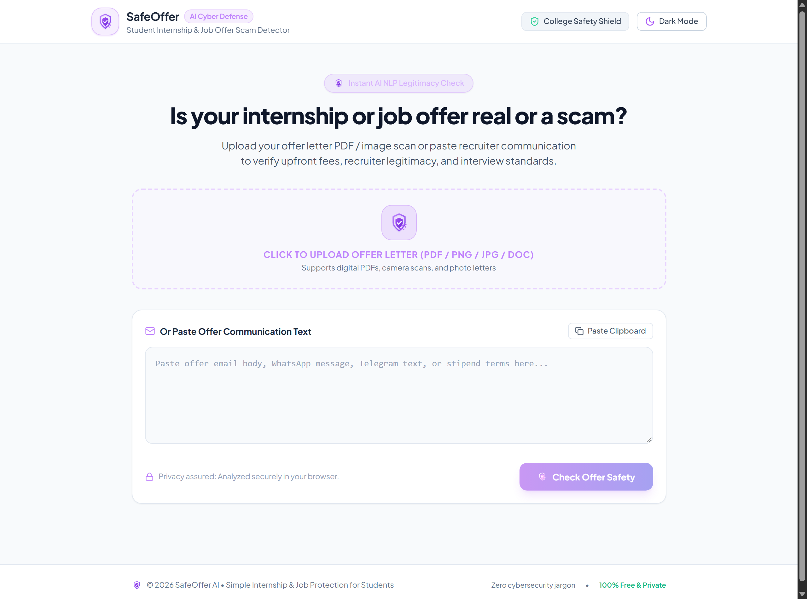
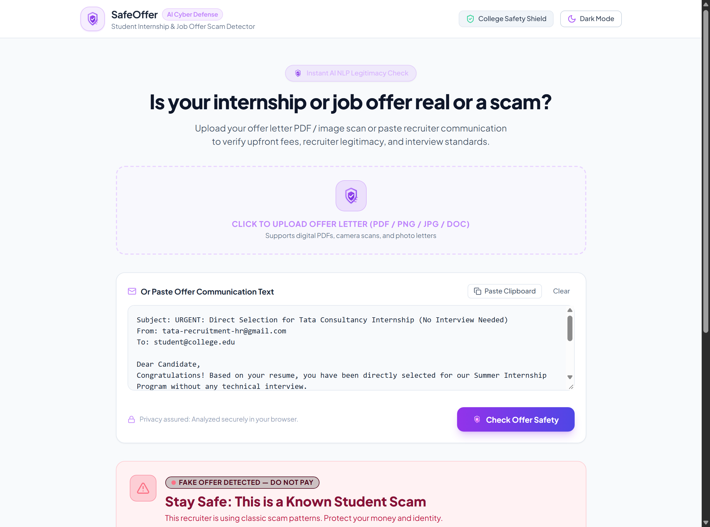
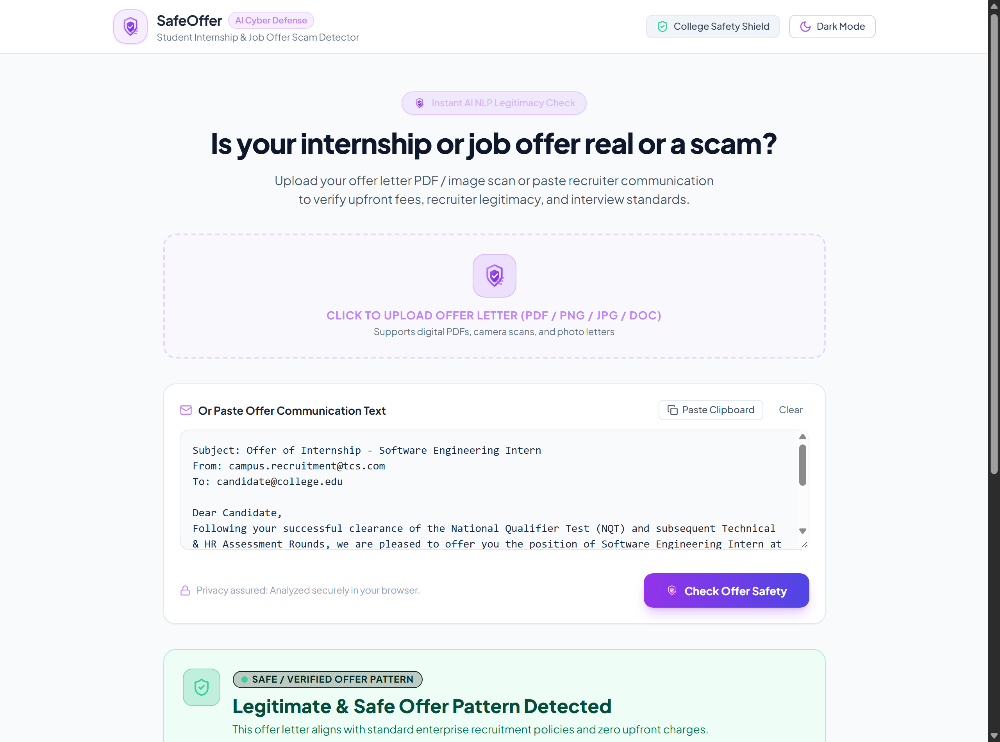
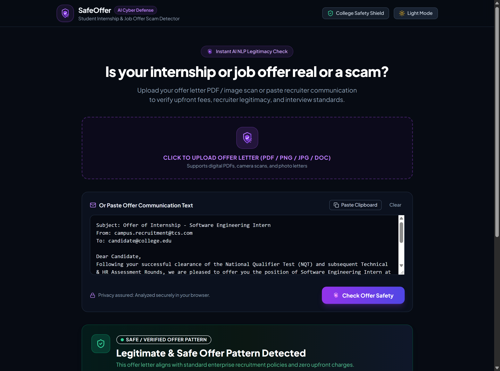
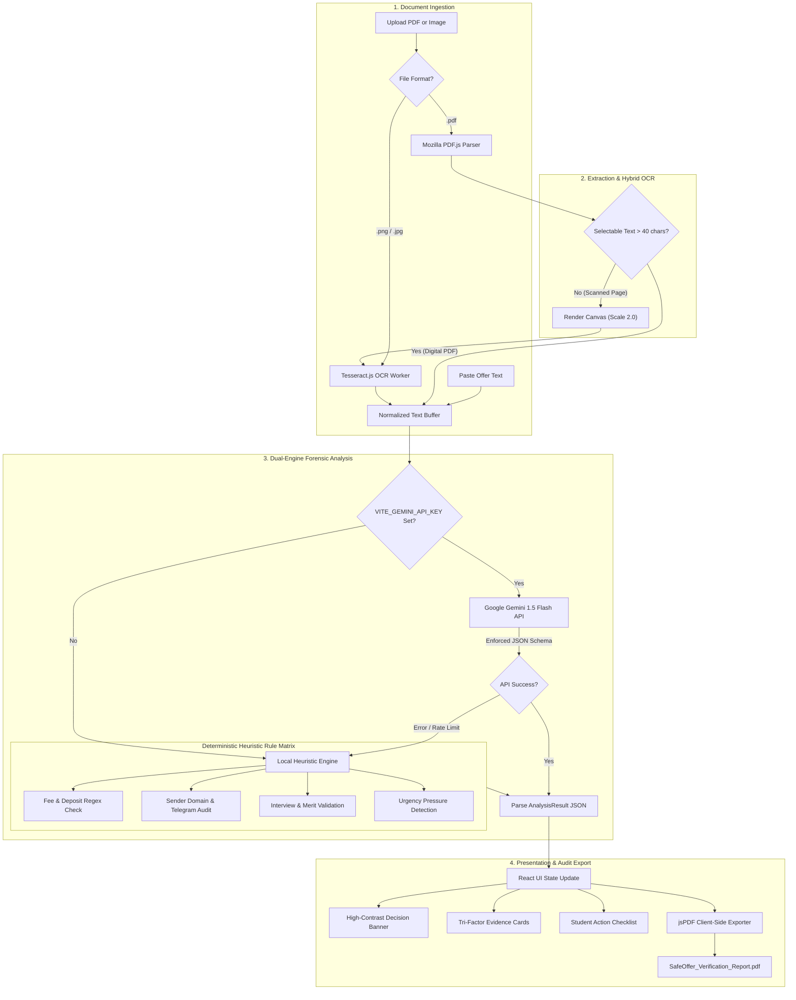

# SafeOffer AI
### *Student Internship & Job Offer Scam Detector*

<p align="center">
  
</p>

<p align="center">
  <strong>Client-side AI and heuristic forensic screening system defending university students against recruitment fraud.</strong>
</p>

<p align="center">
  
  
  
  
  
  
</p>

---

## ⚡ 60-Second Summary
> **SafeOffer AI** is a cyber defense screening web application built for **TCS Hackathon 2026** (shortlisted among the **Top 7 Finalist Teams**).
> It protects students from fraudulent internship letters, fake campus placements, and recruiter extortion scams.
> The platform features a dual-engine architecture: a cloud-powered **Google Gemini 1.5 Flash** semantic analyzer backed by an offline, zero-latency **deterministic heuristic regex engine** that operates with 100% reliability.
> SafeOffer AI ingests raw text, digital PDFs (`pdfjs-dist`), and scanned images or photo letters (`tesseract.js` OCR via 2.0x canvas rendering), evaluates threats across three forensic pillars (Fee Demand, Recruiter Channel, and Interview Integrity), and exports timestamped audit reports via `jspdf`.

---

## 📋 Project Details

| Parameter | Specification |
| :--- | :--- |
| **Hackathon** | TCS Hackathon 2026 |
| **Track & Problem Statement** | AI & Cyber Defense · Student Recruitment & Internship Fraud Detection (PS3) |
| **Recognition** | **Top 7 Finalist Teams** |
| **Team Lead & Lead Developer** | Samuel Michael Alva |
| **Architecture** | Client-First React SPA · Gemini 1.5 Flash API · Heuristic Regex Engine · Tesseract.js OCR |
| **Status** | Hackathon Finalist Prototype |

---

## Table of Contents

* [01. Project Overview](#01-project-overview)
* [02. Problem Statement & Solution](#02-problem-statement--solution)
* [03. Key Features](#03-key-features)
* [04. Screenshots & Live Application Walkthrough](#04-screenshots--live-application-walkthrough)
* [05. System Architecture](#05-system-architecture)
* [06. Fraud Detection Methodology](#06-fraud-detection-methodology)
* [07. Document Processing & OCR Pipeline](#07-document-processing--ocr-pipeline)
* [08. Technology Stack](#08-technology-stack)
* [09. Project Structure](#09-project-structure)
* [10. Installation & Setup](#10-installation--setup)
* [11. Prototype Limitations & Privacy](#11-prototype-limitations--privacy)
* [12. Team & Contributions](#12-team--contributions)

---

## 01. Project Overview

During campus placement seasons, recruitment scams surge dramatically. Malicious operators exploit students' career anxiety and lack of corporate hiring experience by circulating fabricated offer letters, impersonating enterprise recruiters (e.g., TCS, Infosys, Wipro, Google), and requesting upfront "laptop deposits," "gate pass fees," or "training registration costs."

**SafeOffer AI** provides an accessible, jargon-free forensic verification tool. Rather than relying solely on cloud APIs that might face network latency or rate limits, SafeOffer AI pairs **Google Gemini 1.5 Flash** semantic intelligence with an offline **heuristic rule matrix**.

The application ingests offer letters through file uploads (PDF, PNG, JPG) or direct text input, normalizes the text through a hybrid digital-extraction and optical character recognition (OCR) pipeline, performs forensic evaluation, and outputs a structured **Decision $\rightarrow$ Reason $\rightarrow$ Next Action** verdict alongside an exportable PDF audit report.

---

## 02. Problem Statement & Solution

### The Recruitment Fraud Threat Model
* **Upfront Fee Solicitations:** Scammers demand non-refundable or "refundable" payments under the guise of laptop distribution, security deposits, gate passes, or seat confirmations via UPI handles (`@gpay`, `@paytm`, `@phonepe`). Genuine corporate employers never charge candidates.
* **Recruiter Webmail Impersonation:** Fraudsters claim corporate affiliations while sending correspondence from free public handles (`@gmail.com`, `@yahoo.com`, `@outlook.com`) rather than authorized corporate domains (`@tcs.com`, `nextstep.tcs.com`).
* **Unregulated Channel Redirection:** Candidates are routed to anonymous Telegram groups (`t.me/...`) to evade enterprise compliance audit trails.
* **Unilateral Selection Without Interview:** Offers are issued immediately based solely on resumes, skipping technical interviews, coding challenges, or evaluation rounds.
* **Coercive Urgency Pressure:** Imposing artificial deadlines ("Pay within 24 hours to secure your seat") to induce panic and prevent consultation with college authorities.

### The SafeOffer AI Solution
SafeOffer AI analyzes offer correspondence against established enterprise hiring standards and outputs:
1. **Clear Decision Banner:** Unambiguous visual determination (`SAFE_LEGITIMATE` vs. `HIGH_RISK_SCAM`).
2. **Tri-Factor Forensic Breakdown:** Specific evidence cards detailing Fee Demand status, Sender Email/Domain integrity, and Interview Process verification.
3. **Actionable Student Guidance:** Direct safety steps, placement cell verification advisories, and the National Cyber Fraud Helpline (1930).
4. **Client-Side Audit Report:** One-click exportable PDF document for submission to college Training & Placement Officers (TPOs) or cybercrime portals.

---

## 03. Key Features

- **Multi-Modal Document Parsing:** Accepts pasted email bodies, WhatsApp messages, digital PDFs, mobile photo letters, and scanned image documents.
- **Hybrid OCR Pipeline:** Automatically extracts digital text via `pdfjs-dist`; if pages lack selectable text, it renders high-resolution HTML5 canvas views (scale 2.0) and executes `tesseract.js` OCR with real-time recognition progress telemetry.
- **Dual-Engine Fraud Analysis:**
  - *Cloud AI Engine:* Evaluates semantic context and subtle conversational deception using Google Gemini 1.5 Flash via REST API with strict JSON schema parsing.
  - *Local Heuristic Fallback:* Zero-latency regex matrix evaluating fee patterns, negative-fee disclaimers, domain spoofing, Telegram channels, and interview criteria.
- **Tri-Factor Forensic Fact Cards:**
  - *Fact 1: Fee Demand* — Detects deposits, registration charges, UPI strings, and currency amounts.
  - *Fact 2: Sender Email & Channel* — Audits public webmail impersonation, Telegram redirects, and verifies legitimate corporate domains.
  - *Fact 3: Interview Validation* — Flags unilateral selections made without technical or behavioral evaluation.
- **Client-Side PDF Audit Generation:** Creates timestamped forensic PDF audit certificates in-browser using `jspdf`.
- **Responsive Security UI:** Fast, mobile-ready Tailwind CSS interface supporting seamless Light and Dark mode toggling.

---

## 04. Screenshots & Live Application Walkthrough

The following screenshots illustrate the primary operational states of SafeOffer AI captured during live testing:

| Landing & Document Ingestion (Light Mode) | Fraud Detection Verdict (High-Risk Scam) |
| :---: | :---: |
|  |  |
| *Hero dropzone supporting PDF/image upload, clipboard paste workspace, and safety shield* | *High-contrast scam banner, Tri-Factor forensic fact cards, and helpline advisory* |

| Legitimate Offer Verification (Safe Pattern) | Cyber Defense Theme (Dark Mode) |
| :---: | :---: |
|  |  |
| *Verified corporate domain, zero-fee compliance detection, and merit-based hiring check* | *Full dark-mode cyber defense UI with responsive layout and real-time safety audit* |

---

## 05. System Architecture

The end-to-end data pipeline routes user inputs through extraction, engine selection, forensic scoring, and client-side rendering:



---

## 06. Fraud Detection Methodology

SafeOffer AI uses a two-tier evaluation methodology: semantic reasoning via Gemini 1.5 Flash and a deterministic regex forensic engine.

### Comparison: Cloud AI Engine vs. Local Heuristic Fallback

| Metric | Google Gemini 1.5 Flash Engine | Local Heuristic Forensic Engine |
| :--- | :--- | :--- |
| **Execution Environment** | Google Generative Language REST Endpoint | In-Browser Client-Side (`src/analyzer.ts`) |
| **Core Mechanism** | Generative LLM contextual reasoning | Deterministic Regular Expressions & Rule Logic |
| **Primary Strength** | Detects nuanced deception, tone, and novel phrasing | 0ms execution latency, zero API quota dependency, works offline |
| **Data Transmission** | Transmits submitted text over HTTPS to Google API | 100% private to the local browser session |
| **Fallback Trigger** | Primary analysis engine when API key is configured | Activates automatically on missing key or network error |

---

### Key Forensic Checks Implemented

#### 1. Upfront Fee & Deposit Detection
Scans for combinations of monetary requests (`registration fee`, `laptop deposit`, `security deposit`, `training charge`, `gate pass`, `seat confirmation`) alongside currency identifiers (`₹`, `Rs.`, `INR`, `$`) and digital payment methods (`UPI`, `GPay`, `Paytm`, `PhonePe`).
* **Zero-Fee Negation Handling:** Accurately parses enterprise disclaimers (e.g., *"TCS never solicits registration fees"*, *"free of cost"*), preventing false positives on legitimate documents.

#### 2. Communication Channel & Recruiter Webmail Impersonation
* **Public Webmail Flags:** Flags recruiters asserting enterprise identity (e.g., Tata, TCS, Infosys, Wipro, Google) while using generic consumer webmail accounts (`@gmail.com`, `@yahoo.com`, `@outlook.com`, `@hotmail.com`, `@rediffmail.com`).
* **Unregulated Channel Redirection:** Flags redirects to anonymous Telegram handles (`t.me/...`, `@...direct`) used to bypass enterprise compliance logging.
* **Verified Corporate Domains:** Recognizes authenticated enterprise domains (`@tcs.com`, `nextstep.tcs.com`, etc.).

#### 3. Interview Process & Merit Verification
* **Selection Without Assessment:** Flags explicit claims of direct hiring without screening (`without any interview`, `no technical interview`, `direct selection based on resume`).
* **Merit-Based Process Recognition:** Identifies standard multi-round evaluations (`technical interview`, `aptitude test`, `coding round`, `hackathon evaluation`, `campus drive`).

#### 4. Urgency Indicators & Coercion Tactics
Detects high-pressure deadlines (`urgent`, `within 24 hours`, `today only`, `respond ASAP`). When combined with payment demands, artificial urgency elevates the classification to `HIGH_RISK_SCAM`.

#### 5. Marketing & Clickbait Spam Filtering
Identifies promotional clickbait newsletters masquerading as student employment communications.

---

## 07. Document Processing & OCR Pipeline

The document ingestion pipeline in [`src/pdfExtractor.ts`](file:///c:/Users/noela/Desktop/Samuel%20Projects/TCShackathon-26/src/pdfExtractor.ts) handles both digital and scanned files:

```
[ Uploaded Document ]
         │
         ├── Image File (.png, .jpg) ───────────────┐
         │                                          │
         └── PDF Document (.pdf)                    │
                  │                                 │
                  ▼                                 │
         pdfjsLib.getDocument()                     │
                  │                                 │
                  ▼                                 │
         page.getTextContent()                      │
                  │                                 │
                  ├── Text > 40 chars (Digital) ────┼──► [ Normalized Text Buffer ]
                  │                                 │
                  └── Text <= 40 chars (Scanned)    │
                           │                        │
                           ▼                        │
                  Render to HTML5 <canvas>          │
                  (Viewport Scale: 2.0)             │
                           │                        │
                           ▼                        │
                  tesseract.js Worker ◄─────────────┘
                  (English OCR Engine)
                           │
                           ▼
                  [ Normalized Text Buffer ]
```

1. **Digital PDF Parsing:** Ingests document bytes into `pdfjs-dist` and iterates through pages to extract selectable text chunks.
2. **High-Resolution Canvas OCR:** If digital text yield is 40 characters or fewer, the page is treated as an image scan. The page is rendered to an HTML5 `<canvas>` at `scale: 2.0` (high DPI) to optimize character edge detection.
3. **Tesseract.js Engine:** The canvas or image file is dispatched to a `tesseract.js` worker (`eng` language data). Live progress telemetry (`Recognizing text: XX%`) is streamed to the user interface.
4. **Audit PDF Export (`jspdf`):** When the user triggers report export, [`src/App.tsx`](file:///c:/Users/noela/Desktop/Samuel%20Projects/TCShackathon-26/src/App.tsx) generates a formatted, printable `SafeOffer_Verification_Report.pdf` detailing verdict, evidence items, and safety checklists.

---

## 08. Technology Stack

| Layer | Technology | Version | Purpose |
| :--- | :--- | :--- | :--- |
| **Frontend Framework** | React | `^18.3.1` | Declarative UI, state management, and component architecture |
| **Language** | TypeScript | `^5.7.3` | Type safety across forensic schemas and document extractors |
| **Build Tooling** | Vite | `^6.1.0` | Development server and production bundling |
| **Styling** | Tailwind CSS | `^3.4.17` | Utility-first styling with integrated dark mode |
| **Iconography** | Lucide React | `^0.475.0` | Clean, accessible iconography |
| **AI Engine** | Google Gemini API | `gemini-1.5-flash` | Cloud semantic evaluation and structured JSON extraction |
| **PDF Extraction** | Mozilla PDF.js | `^3.11.174` | In-browser parsing and rendering of PDF documents |
| **OCR Engine** | Tesseract.js | `^7.0.0` | Client-side OCR worker for image and scan transcription |
| **Report Generation** | jsPDF | `^2.5.2` | Client-side generation of forensic audit PDF reports |

---

## 09. Project Structure

```
TCShackathon-26/
├── screenshots/                 # Application walkthrough screenshots
│   ├── 01_landing_interface.png
│   ├── 02_scam_detection_verdict.png
│   ├── 03_safe_verified_verdict.png
│   └── 04_dark_mode_interface.png
├── public/
│   └── logo.svg                 # Brand vector asset
├── src/
│   ├── analyzer.ts              # Gemini API client & Deterministic Heuristic Engine
│   ├── App.tsx                  # Main UI layout, upload handler & jsPDF exporter
│   ├── index.css                # Tailwind directives and font configurations
│   ├── Logo.tsx                 # Brand logo component
│   ├── main.tsx                 # Application DOM entry point
│   ├── pdfExtractor.ts          # PDF.js digital extractor & Tesseract.js OCR pipeline
│   └── vite-env.d.ts            # Vite client environment declarations
├── index.html                   # HTML entry point with Plus Jakarta Sans typography
├── package.json                 # Dependency definitions and scripts
├── postcss.config.js            # PostCSS configuration
├── tailwind.config.js           # Tailwind theme tokens and dark mode config
├── tsconfig.json                # TypeScript compiler configuration
├── vite.config.ts               # Vite bundler configuration
└── README.md                    # Project documentation
```

---

## 10. Installation & Setup

### Prerequisites
* **Node.js:** v18.0.0 or higher
* **npm:** v9.0.0 or higher

### 1. Clone the Repository
```bash
git clone https://github.com/samuelmichaelalva/TCShackathon-26.git
cd TCShackathon-26
```

### 2. Install Dependencies
```bash
npm install
```

### 3. Configure Environment Variables (Optional)
SafeOffer AI operates completely offline out-of-the-box using the local heuristic forensic engine. To enable cloud-powered semantic analysis via Gemini 1.5 Flash, create a `.env` file in the project root:

```bash
touch .env
```

Add your Gemini API key:
```env
VITE_GEMINI_API_KEY=your_google_gemini_api_key_here
```

> **Note:** If `VITE_GEMINI_API_KEY` is omitted, the application automatically routes all evaluations through the local heuristic engine with zero functionality loss.

### 4. Run the Development Server
```bash
npm run dev
```
Open `http://localhost:5173` in your browser.

### 5. Build for Production
```bash
npm run build
npm run preview
```

---

## 11. Prototype Limitations & Privacy

### Prototype Boundaries
1. **Preliminary Forensic Screening Only:** SafeOffer AI is designed as a first-line educational and forensic screening tool. It does **not** replace official verification by corporate human resources or college placement officers (TPOs), and does not legally certify contract validity.
2. **No Live External Network Checks:** The system does not query DNS MX/SPF/DKIM/DMARC records in real time, nor does it connect to government corporate registries (e.g., MCA).
3. **Image Quality & OCR Dependency:** Heavily degraded, blurred, or skewed camera scans may impede optical character recognition, causing heuristic rules to miss critical text.

### Privacy Architecture
* **Gemini AI Mode:** When configured with an API key, submitted offer text is sent over HTTPS to Google's Generative Language API (`generativelanguage.googleapis.com`) for analysis.
* **Local Heuristic Mode:** When operating without an API key, **100% of the analysis, regex matching, and OCR processing executes locally within your browser**. No user data or document text leaves your machine.

---

## 12. Team & Contributions

SafeOffer AI was developed during **TCS Hackathon 2026** under the **AI & Cyber Defense Track** (Problem Statement: Student Recruitment & Internship Fraud Detection), qualifying as one of the **Top 7 Finalist Teams**.

| Member | Role | Responsibilities |
| :--- | :--- | :--- |
| **Samuel Michael Alva** | **Team Lead & Application Developer** | Project coordination, frontend architecture, Gemini API & heuristic engine implementation, and OCR/PDF pipeline. |
| **Justin Sunil** | **Team Member** | Problem research, threat modeling, and recruitment scam patterns. |
| **Arya Gunjotikar** | **Team Member** | Communication channel analysis (Telegram/webmail fraud) and user workflow scoping. |
| **Renata Belli** | **Team Member** | Solution evaluation criteria and hackathon presentation deck. |
| **Ritu Shinde** | **Team Member** | Enterprise hiring benchmark research and pitch asset preparation. |

---

<div align="center">
  <sub>Built for TCS Hackathon 2026 · Top 7 Finalist · Team SafeOffer AI</sub>
</div>
