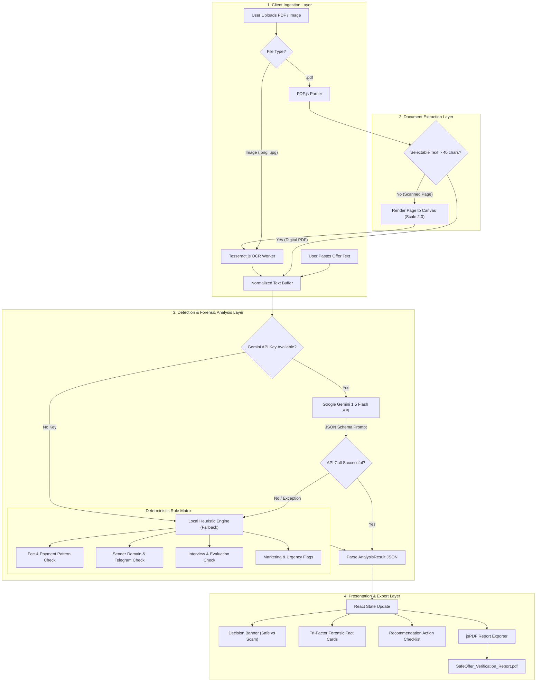

# SafeOffer AI — Student Internship & Job Offer Scam Detector

<p align="center">
  
</p>

<p align="center">
  <strong>Client-side AI & heuristic forensic screening system defending students against recruitment fraud.</strong>
</p>

<p align="center">
  
  
  
  
  
  
</p>

---

## 1. Project Overview

**SafeOffer AI** is an intelligent, client-first forensic screening application designed to protect college students, recent graduates, and job seekers from recruitment fraud, fake internship letters, and employment phishing scams.

Employment scams targeting students have grown increasingly sophisticated. Fraudulent operators clone enterprise branding, craft deceptive offer letters, issue unilateral appointments without prior technical evaluation, and coerce victims into paying upfront "laptop deposits," "training charges," or "registration fees."

SafeOffer AI provides instant, transparent, and actionable verification by combining:
1. **Context-Aware Generative AI Analysis:** Powered by Google's `gemini-1.5-flash` model for semantic comprehension of deceptive recruiter language and novel scam patterns.
2. **Deterministic Heuristic Forensic Fallback:** A comprehensive rule-based regex engine that flags critical fraud signals offline with zero latency and 100% demo reliability.
3. **Hybrid Document Ingestion Pipeline:** Capable of reading raw text, extracting digital text from PDFs using `pdfjs-dist`, and executing optical character recognition (OCR) on scanned documents and image formats using `tesseract.js`.
4. **Forensic Audit PDF Generation:** Exportable audit reports produced client-side via `jspdf` for submission to College Training & Placement Officers (TPOs) or cybercrime reporting portals.

---

## 2. Problem Statement & Proposed Solution

### The Problem
During campus recruitment seasons, students face intense pressure to secure internships and entry-level positions. Malicious actors exploit this urgency through well-documented predatory patterns:
- **Financial Solicitations:** Requesting mandatory deposits under the guise of security fees, equipment delivery, seat confirmation, or gate passes.
- **Identity & Domain Impersonation:** Pretending to represent reputed multinational enterprises (e.g., TCS, Infosys, Google, Wipro) while communicating via generic webmail accounts (`@gmail.com`, `@yahoo.com`) or redirecting conversations to unregulated channels such as Telegram.
- **Bypassed Assessment Integrity:** Granting immediate job offers without interviews, coding assessments, or portfolio reviews to induce false relief and compliance.
- **High-Pressure Urgency Tactics:** Imposing artificial deadlines (e.g., "Respond within 2 hours" or "Offer expires today") to force hurried monetary transfers before the applicant can consult peers or placement authorities.

### The Proposed Solution
SafeOffer AI addresses this challenge with a **"Decision $\rightarrow$ Reason $\rightarrow$ Next Action"** evaluation framework:
- **Instant Triage:** Classifies documents into clear, non-jargon outcomes (`SAFE_LEGITIMATE` vs. `HIGH_RISK_SCAM`).
- **Tri-Factor Forensic Fact Breakdown:** Details the specific evidence behind the classification across three investigative pillars: Fee Demand, Sender Communication Channel, and Interview Process Integrity.
- **Prescriptive Next Steps:** Delivers a concrete safety checklist, direct references to the National Cyber Fraud Helpline (1930), and downloadable verification audits.

---

## 3. Key Features

- **Multi-Modal Document Input:**
  - Direct text input via clipboard paste or typing for email bodies, WhatsApp messages, and direct messages.
  - Native file upload supporting `.pdf`, `.png`, `.jpg`, `.jpeg`, and `.txt` files.
- **Hybrid Document Extraction Engine:**
  - Digital PDF parsing using Mozilla's `pdfjs-dist`.
  - Automated fallback to HTML5 Canvas rendering (scale 2.0) and `tesseract.js` OCR when PDFs contain scanned images or non-selectable text.
  - Real-time recognition progress tracking (0% to 100%) during OCR processing.
- **Dual-Engine Detection Architecture:**
  - **AI Mode:** REST integration with Google Gemini 1.5 Flash using strict JSON schema validation.
  - **Heuristic Mode:** Offline, high-coverage regex forensic engine checking fee patterns, zero-fee negation clauses, recruiter domains, interview mentions, and marketing clickbait.
- **Forensic Tri-Factor Breakdown:**
  - **Fact 1: Fee Demand Analysis** — Detects direct payment requests, security deposits, UPI IDs, and currency references while respecting legitimate corporate disclaimers.
  - **Fact 2: Communication Channel Audit** — Identifies public webmail impersonation, unauthorized Telegram redirects, and verifies legitimate corporate domains.
  - **Fact 3: Interview Validation** — Verifies whether structured technical interviews or assessments occurred versus instant, unverified selection.
- **Client-Side PDF Audit Export:**
  - Generates a timestamped, structured verification report in PDF format with one click using `jspdf`.
- **Responsive & Accessible Interface:**
  - Built with Tailwind CSS and Lucide React.
  - Fully functional Light Mode and Dark Mode toggle.
  - Instant reset and re-scan capabilities.

---

## 4. Screenshots & Application Walkthrough

The SafeOffer AI interface follows a structured, step-by-step forensic evaluation workflow:

```
+-----------------------------------------------------------------------------------+
|  [Logo] SafeOffer  AI Cyber Defense         [College Safety Shield] [Toggle Theme] |
+-----------------------------------------------------------------------------------+
|                                                                                   |
|                Is your internship or job offer real or a scam?                    |
|       Upload your offer letter PDF / image scan or paste recruiter communication   |
|                                                                                   |
|   +---------------------------------------------------------------------------+   |
|   |   [ Upload Icon ]                                                         |   |
|   |   CLICK TO UPLOAD OFFER LETTER (PDF / PNG / JPG / DOC)                    |   |
|   |   Supports digital PDFs, camera scans, and photo letters                  |   |
|   +---------------------------------------------------------------------------+   |
|                                                                                   |
|   +---------------------------------------------------------------------------+   |
|   |   [Mail Icon] Or Paste Offer Communication Text      [Paste] [Clear]      |   |
|   |   +---------------------------------------------------------------------+ |   |
|   |   | Paste offer email body, WhatsApp message, Telegram text...          | |   |
|   |   +---------------------------------------------------------------------+ |   |
|   |   (Lock) Privacy assured: Analyzed securely       [ Check Offer Safety ]  |   |
|   +---------------------------------------------------------------------------+   |
|                                                                                   |
|   ========================= FORENSIC AUDIT RESULTS =========================     |
|                                                                                   |
|   +---------------------------------------------------------------------------+   |
|   | [!] HIGH RISK SCAM / FAKE OFFER DETECTED — DO NOT PAY                     |   |
|   | Stay Safe: This is a Known Student Scam                                   |   |
|   | This recruiter is using classic scam patterns. Protect your money.        |   |
|   +---------------------------------------------------------------------------+   |
|                                                                                   |
|   +-------------------+   +--------------------+   +-----------------------+      |
|   | FACT 1: FEE DEMAND|   |FACT 2: SENDER EMAIL|   |FACT 3: INTERVIEW PROC |      |
|   | ⚠️ ₹2,500 Requested|   | ⚠️ Telegram Channel|   | ⚠️ No Interview Found |      |
|   | Rule: Genuine jobs|   | Rule: Official com-|   | Rule: Real internships|      |
|   | pay you, not vice |   | panies use verified|   | require technical     |      |
|   | versa.            |   | domains.           |   | evaluation rounds.    |      |
|   +-------------------+   +--------------------+   +-----------------------+      |
|                                                                                   |
|   +---------------------------------------------------------------------------+   |
|   | [ Download Report ]   [ Reset & Scan Another ]    Helpline: 1930 (Toll-Free) |   |
|   +---------------------------------------------------------------------------+   |
+-----------------------------------------------------------------------------------+
```

### Application Walkthrough Steps

1. **Document Ingestion:** The user either drags and drops an offer letter file (`.pdf`, `.png`, `.jpg`) into the dedicated dropzone or pastes raw text directly into the input workspace.
2. **Text Processing & OCR:**
   - If a digital PDF is supplied, `pdfjs-dist` reads the textual streams page by page.
   - If a scanned PDF or photograph is supplied, pages are rendered to high-resolution canvas surfaces and processed via the `tesseract.js` OCR worker with live status updates.
3. **Safety Evaluation:** Clicking **"Check Offer Safety"** triggers the forensic analysis via Gemini 1.5 Flash (or the local heuristic engine if no API key is configured).
4. **Verdict Banner:** Displays an instant color-coded visual indicator (`HIGH_RISK_SCAM` in rose/crimson or `SAFE_LEGITIMATE` in emerald).
5. **Tri-Factor Forensic Fact Cards:** Provides targeted analysis of the payment request, sender domain integrity, and interview process legitimacy.
6. **Action & Audit Export:** The student can review the safety recommendations, call the National Cyber Fraud Helpline (1930), or download an official `SafeOffer_Verification_Report.pdf` document.

---

## 5. System Architecture

The following diagram illustrates the complete data flow, from user input to final risk assessment and PDF report generation:



---

## 6. Fraud Detection Methodology

SafeOffer AI employs a two-tier analysis methodology: context-aware Large Language Model (LLM) reasoning and an offline deterministic heuristic forensic engine.

### Comparison: AI Analysis vs. Heuristic Detection

| Attribute | Gemini 1.5 Flash AI Engine | Local Heuristic Forensic Engine |
| :--- | :--- | :--- |
| **Execution Context** | Cloud-based (`generativelanguage.googleapis.com`) | 100% In-Browser (Client-side execution) |
| **Detection Method** | Generative NLP context modeling & semantic reasoning | Deterministic Regex & Boolean rule matrix |
| **Strengths** | Understands novel phrasing, implicit pressure, and complex context | Zero latency, operates offline, zero API quota dependency |
| **Output Format** | Structured JSON enforcing `AnalysisResult` schema | Native `AnalysisResult` TypeScript object |
| **Activation** | Active when `VITE_GEMINI_API_KEY` is present | Active by default, or as automatic fallback on API error |

---

### Detailed Forensic Checks

#### 1. Suspicious Fee & Payment Requests
- **Detection Logic:** Scans for keywords associated with upfront financial extraction (`registration fee`, `processing charge`, `training fee`, `laptop deposit`, `security deposit`, `caution amount`, `gate pass`, `seat confirmation`).
- **Payment Method Identifiers:** Flags mentions of instant transfer mechanisms (`UPI`, `GPay`, `Paytm`, `PhonePe`, QR codes, direct account numbers) alongside currency symbols (`₹`, `Rs.`, `INR`, `$`).
- **Zero-Fee Negation Handling:** Avoids false positives by evaluating disclaimers such as `"never solicits registration"`, `"does not charge any fee"`, or `"free of cost"`.

#### 2. Communication Channels & Recruiter Identity
- **Telegram Redirection:** Detects links and handles matching `telegram`, `t.me/`, or `@...direct`. Legitimate corporate recruitment workflows do not conduct onboarding or interviews exclusively over anonymous messaging channels.
- **Public Webmail Impersonation:** Flags recruiters claiming to represent established brands (e.g., TCS, Infosys, Wipro, Google, Microsoft) while using free webmail providers (`@gmail.com`, `@yahoo.com`, `@outlook.com`, `@hotmail.com`, `@rediffmail.com`).
- **Verified Enterprise Domains:** Validates official recruitment portals (e.g., `@tcs.com`, `nextstep.tcs.com`).

#### 3. Interview Process & Merit Verification
- **Unilateral Selection:** Flags phrases indicating an offer was issued without merit evaluation (`without any interview`, `no technical interview`, `direct selection based on resume`).
- **Merit-Based Assessment Recognition:** Identifies standard corporate hiring stages (`technical interview`, `aptitude test`, `coding assessment`, `hackathon evaluation`, `campus drive`).

#### 4. Urgency Indicators & Psychological Coercion
- **Artificial Pressure:** Detects phrases engineered to bypass critical thinking (`urgent`, `within 24 hours`, `today only`, `respond ASAP`). When combined with payment requests, urgency triggers immediate high-risk classification.

#### 5. Promotional & Clickbait Spam Filtering
- **Non-Offer Content:** Filters out marketing newsletters, LinkedIn clickbait, and promotional spam masquerading as genuine job communications.

---

## 7. Document Processing: PDF Extraction & OCR

Offer letters are frequently delivered in varied formats, from native vector PDFs to scanned image files and mobile photos. SafeOffer AI implements a multi-stage text extraction pipeline in [`src/pdfExtractor.ts`](file:///c:/Users/noela/Desktop/Samuel%20Projects/TCShackathon-26/src/pdfExtractor.ts):

```
File Upload (.pdf / .png / .jpg)
        |
        +---> Is Image? ---> Tesseract.js Worker ---> Extracted Text
        |
        +---> Is PDF?
                |
                v
        pdfjsLib.getDocument()
                |
                +---> Page 1..N: getTextContent()
                        |
                        +---> Length > 40 chars?
                                |
                                +--[Yes]--> Append digital text
                                |
                                +--[No]--> Render page to <canvas> (scale: 2.0)
                                            |
                                            v
                                     performOCR(canvas)
                                            |
                                            v
                                     Append OCR text
```

### Digital PDF Processing (`pdfjs-dist`)
1. Reads the uploaded `File` as an `ArrayBuffer`.
2. Loads the document using `pdfjsLib.getDocument({ data: arrayBuffer })`.
3. Iterates through all pages, retrieving text chunks using `page.getTextContent()`.
4. Merges textual items into a single string per page.

### Scanned Document Fallback & Canvas OCR (`tesseract.js`)
If a PDF page yields 40 characters or fewer of digital text, it is classified as a scanned image document:
1. A viewport is created at high resolution (`scale: 2.0`) to preserve fine typographical details.
2. An off-screen HTML5 `<canvas>` element is dynamically instantiated matching the viewport dimensions.
3. The PDF page is rendered onto the canvas 2D context using `page.render({ canvasContext, viewport })`.
4. The canvas image data is passed to `tesseract.js` via an English language worker (`createWorker('eng', 1)`).
5. Progress updates (`m.status === 'recognizing text'`) are emitted back to the React UI in real time.
6. The worker terminates upon completion (`worker.terminate()`) to release browser memory.

### PDF Report Generation (`jspdf`)
When the user clicks **Download Report**, the application invokes `handleExportPDF()` in [`src/App.tsx`](file:///c:/Users/noela/Desktop/Samuel%20Projects/TCShackathon-26/src/App.tsx):
- Instantiates a clean document via `new jsPDF()`.
- Renders header typography, generation timestamp, and overall verdict.
- Formats each forensic factor (Fee Demand, Recruiter Channel, Interview Process).
- Includes the actionable student safety checklist.
- Exports the audit file as `SafeOffer_Verification_Report.pdf`.

---

## 8. Technology Stack

| Layer | Technology | Version | Purpose |
| :--- | :--- | :--- | :--- |
| **Core Framework** | React | `^18.3.1` | Declarative user interface and component state management |
| **Language** | TypeScript | `^5.7.3` | Type safety across forensic schemas and document extractors |
| **Build Tooling** | Vite | `^6.1.0` | High-speed local development server and optimized bundler |
| **Styling & Design** | Tailwind CSS | `^3.4.17` | Responsive utility-first design system with dark mode support |
| **Iconography** | Lucide React | `^0.475.0` | Accessible and consistent interface icons |
| **AI Integration** | Google Gemini API | `gemini-1.5-flash` | Cloud-based generative semantic analysis and JSON extraction |
| **PDF Extraction** | PDF.js (`pdfjs-dist`) | `^3.11.174` | In-browser parsing and rendering of portable document format files |
| **Optical Character Recognition** | Tesseract.js | `^7.0.0` | Client-side OCR worker for image and scanned document transcription |
| **Audit Document Generation** | jsPDF | `^2.5.2` | Client-side generation and export of forensic verification reports |

---

## 9. Project Structure

```
TCShackathon-26/
├── public/
│   └── logo.svg                 # Application brand vector icon
├── src/
│   ├── analyzer.ts              # Gemini API integration & Heuristic Rule Engine
│   ├── App.tsx                  # Primary application UI, state & PDF export logic
│   ├── index.css                # Global styles & Tailwind CSS imports
│   ├── Logo.tsx                 # Reusable logo component wrapper
│   ├── main.tsx                 # React DOM root entry point
│   ├── pdfExtractor.ts          # PDF.js digital text extraction & Tesseract.js OCR
│   └── vite-env.d.ts            # Vite client environment type definitions
├── index.html                   # HTML entry point with fonts & metadata
├── package.json                 # Project dependencies & operational scripts
├── postcss.config.js            # PostCSS configuration for Tailwind CSS
├── tailwind.config.js           # Tailwind design tokens, typography & dark mode setup
├── tsconfig.json                # TypeScript compiler configuration
├── vite.config.ts               # Vite configuration with React plugin
└── README.md                    # Project documentation
```

---

## 10. Installation & Execution

### Prerequisites
- **Node.js:** v18.0.0 or higher
- **Package Manager:** `npm` (bundled with Node.js)

### 1. Clone the Repository
```bash
git clone https://github.com/samuelmichaelalva/TCShackathon-26.git
cd TCShackathon-26
```

### 2. Install Dependencies
```bash
npm install
```

### 3. Configure Environment Variables (Optional)
The application functions out-of-the-box using the local heuristic forensic engine without any API keys. To enable cloud-based AI analysis via Google Gemini, create a `.env` file in the project root:

```bash
touch .env
```

Add your Gemini API key:
```env
VITE_GEMINI_API_KEY=your_google_gemini_api_key_here
```

> **Note:** If `VITE_GEMINI_API_KEY` is not provided, SafeOffer AI automatically routes all evaluations through the local heuristic engine.

### 4. Run the Development Server
```bash
npm run dev
```
Open your browser and navigate to `http://localhost:5173` (or the URL displayed in your terminal).

### 5. Production Build & Preview
```bash
# Typecheck and bundle for production
npm run build

# Preview production build locally
npm run preview
```

---

## 11. Limitations & Future Scope

### Limitations & Preliminary Nature of Assessment
- **Preliminary Screening Only:** SafeOffer AI is designed as a first-line screening and educational risk assessment tool. It does **not** provide definitive legal or corporate verification of employment contracts.
- **External Network Checks:** The system does not perform live DNS MX, SPF, DKIM, or DMARC record lookups, nor does it query government corporate registry databases (such as the Ministry of Corporate Affairs).
- **OCR Quality Dependencies:** Severely degraded, skewed, or low-contrast document images may result in incomplete transcription, potentially causing heuristic rules to miss critical text.
- **Privacy Notice:** When configured with a Gemini API key (`VITE_GEMINI_API_KEY`), submitted offer text is sent over HTTPS to Google's Generative Language API endpoint (`generativelanguage.googleapis.com`) for analysis. When operated without an API key, all evaluation and OCR processing execute entirely inside the user's browser.

### Future Scope
- **Live Enterprise Domain & DNS Verification:** Integrating active SPF/DKIM validation and WHOIS age checks to identify newly registered lookalike domains.
- **Direct Portal Integration:** Integrating APIs with verified student recruitment portals (e.g., TCS NextStep, Infosys Launchpad) for automated offer ID validation.
- **On-Device Small Language Model (SLM):** Implementing in-browser model execution (e.g., WebLLM or ONNX Runtime) to provide semantic AI analysis without external API calls.
- **Multi-Lingual OCR:** Expanding OCR language models to support regional Indian languages for vernacular offer letters.

---

## 12. Hackathon Details & Team Contributions

### TCS Hackathon 2026
SafeOffer AI was conceptualized, designed, and developed for **TCS Hackathon 2026** under the **AI & Cyber Defense Track (Problem Statement: Student Recruitment & Internship Fraud Detection)**, where it was shortlisted among the **Top 7 Finalist Teams**.

### Team Members

| Name | Role / Project Contribution |
| :--- | :--- |
| **Samuel Michael Alva** | **Team Lead & Application Developer**<br>Led project architecture and end-to-end technical implementation, including the dual-engine forensic detection system (Gemini 1.5 Flash API integration and deterministic heuristic engine), hybrid PDF.js and Tesseract.js OCR pipeline, client-side jsPDF audit report generator, and responsive UI engineering. |
| **Justin Sunil** | **Team Member** |
| **Arya Gunjotikar** | **Team Member** |
| **Renata Belli** | **Team Member** |
| **Ritu Shinde** | **Team Member** |

---

## License & Advisory

This project was built for educational and hackathon evaluation purposes. If you suspect you are being targeted by an active employment scam in India, immediately contact your **College Placement Cell / TPO** and register a complaint with the **National Cyber Crime Reporting Portal** ([cybercrime.gov.in](https://cybercrime.gov.in/)) or dial the **National Cyber Fraud Helpline: 1930**.
